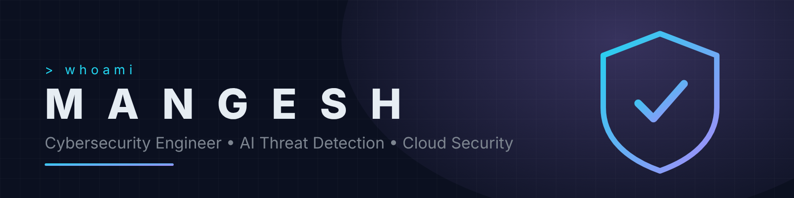
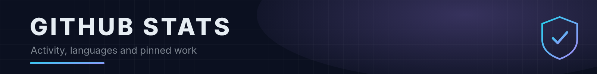
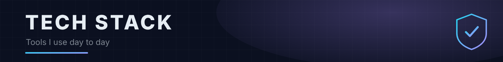
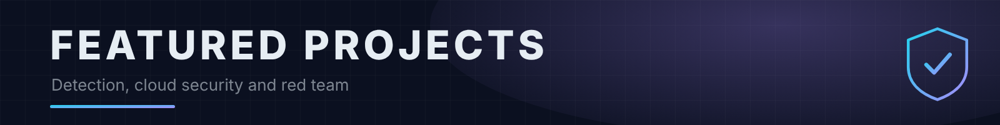

# M A N G E S H

### **Cybersecurity Engineer • AI Threat Detection • Cloud Security**

`Threat Detection` • `DevSecOps` • `Cloud Security` • `Red Teaming` • `SIEM` • `Threat Intelligence` • `AI Security` • `Zero Trust`

### *Building Detection Systems, Cloud Security Tooling & Autonomous Defense.*

---

# 👋 About Me

I design detection and response systems that combine machine learning, automation, and cloud security. I'm pursuing a Master of Information Technology Security (Artificial Intelligence) at Ontario Tech University, Canada's first AI-in-Security program.

My background blends hands-on SOC, DevSecOps, and threat-intelligence work with applied research in AI for cybersecurity: real-time anomaly detection, autonomous defense, and cyber resilience. Capstone: AI-powered microgrid security monitoring for nuclear-adjacent environments.

📫 Open to full-time and contract cybersecurity roles.

---

<table>
<tr>
<td align="center">

</td>

<td align="center">

</td>
</tr>

<tr>
<td align="center">

</td>

<td align="center">

</td>
</tr>

<tr>
<td align="center">

</td>

<td align="center">

</td>
</tr>

<tr>
<td align="center">

</td>

<td align="center">

</td>
</tr>

</table>

---

### Languages

### Cloud & DevSecOps

### AI & Data

### Offensive Security

### SIEM, Frameworks & Compliance

---

# 🧠 Current Focus

<table>
  <tr><td>AI Threat Detection</td><td>UEBA & Anomaly Detection</td><td>Malware Classification</td></tr>
  <tr><td>Cloud Security (AWS & Azure)</td><td>Zero Trust Architecture</td><td>DevSecOps</td></tr>
  <tr><td>SIEM & Log Correlation</td><td>Automated Incident Response</td><td>Threat Intelligence</td></tr>
  <tr><td>Purple Teaming</td><td>MITRE ATT&CK Emulation</td><td>Web & Mobile Pentesting</td></tr>
</table>

---

| Project | Description |
|----------|-------------|
| Threat-Intelligence-Automated-Research-and-Analysis-AI-Tool | AI-assisted threat-intel research tool enriching IOCs via VirusTotal & ThreatFox |
| AI-Automated-Security-Engineer | Vulnerability scanning, threat detection, and automated remediation reporting with ML/NLP |
| canarie-aws-cloud-threat-intelligence-project | AWS + ELK Stack observability and threat-intelligence pipeline for SMEs |
| Ransomware-Detection-System | Real-time file/process monitoring with automated alerting and protective response |
| Purple Team Automation Framework (PTAF) | AI-driven Purple Team automation framework for offensive simulation and defensive detection engineering |
| threat-intelligence-data-analysis | Threat intelligence platform with AI anomaly detection and a real-time Streamlit dashboard |
| Active Directory Red Team Lab | An end-to-end Active Directory attack-and-detection lab with a real-time cross-platform GUI, MITRE ATT&CK mappings, and production-ready SIEM detection rules. |

---

# 🏅 Certifications

`(ISC)² Candidate` · `Certified Ethical Hacker (CEH)` · `Microsoft Certified: Azure Fundamentals` · `CCNA` · `CCSK` · `IBM AI Engineering Professional Certificate` · `PCEP-30-01` · `Google IT Automation with Python`

Plus TryHackMe paths: `Security Engineer` `Offensive Pentesting` `Red Teaming` `DevSecOps` `Advanced Endpoint Investigations` `Jr. Penetration Tester` `Pre Security` `Advent of Cyber 2025`

---

